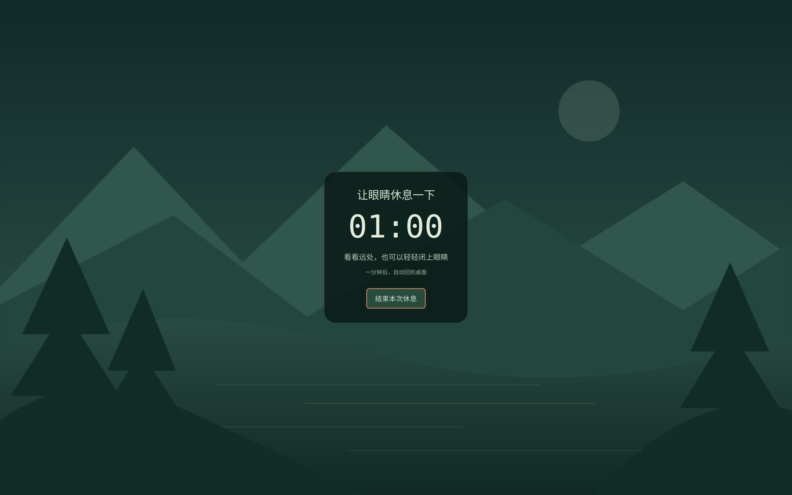

# Eye Rest · 护眼休息

一个轻量的 Ubuntu 桌面休息提醒工具。每到整点，自动以全屏图片覆盖桌面，显示 **60 秒倒计时**；时间结束后恢复桌面，提醒自己暂时离开屏幕、看看远处。

程序使用 Python 和 GTK 3，提供中文界面、可拖动浮窗、自定义图片和登录自启动功能。本地运行，无需注册账号，不发送网络请求。

## 界面预览

桌面浮窗：显示下一次休息时间，可打开菜单或退出程序。


全屏休息页面：默认使用深绿色山水背景，保留结束本次休息的按钮。



## 主要功能

| 功能 | 说明 |
| --- | --- |
| 整点提醒 | 按系统当地时间，在每小时整点自动开始休息 |
| 一分钟倒计时 | 全屏显示 60 秒，结束后自动恢复桌面 |
| 桌面浮窗 | 显示下次休息时间，支持拖动并记住位置 |
| 自定义背景 | 支持 PNG、JPEG，选择时预览，自动保存本地副本 |
| 登录自启动 | 用户级安装，登录桌面后自动运行，可在菜单中关闭 |
| 随时退出 | 休息页面可提前结束，浮窗可退出整个程序 |
| 单实例运行 | 重复启动不会产生多个浮窗或叠加倒计时 |
| 多显示器处理 | 为每个显示器创建休息页面，布局变化时重新适配 |
| 锁屏与休眠处理 | 跳过错过的整点，解锁或唤醒后等待下一个整点 |

## 运行环境

- **适配环境**：Ubuntu 24.04、GNOME、X11。
- **已验证运行时**：Python 3.12、GTK 3.24。
- **依赖**：系统 Python 3、PyGObject、GTK 3、Pillow。
- **其他系统**：本版未适配 Windows、macOS；Wayland 的浮窗定位和置顶行为未作为验收范围。

Ubuntu 如缺少依赖，可先安装：

```sh
sudo apt install python3-gi gir1.2-gtk-3.0 python3-pil
```

安装上述系统依赖可能需要管理员权限；安装 Eye Rest 本身不需要。

## 安装与启动

进入 `eye-rest` 源码目录后执行：

```sh
./install.sh
```

安装到当前用户目录，默认开启登录桌面自启动并立即运行，不需要 sudo。可以从应用菜单搜索“护眼休息”。安装后的程序与源码独立，移动源码不影响使用。

仅直接运行，不安装：

```sh
./start.sh
```

## 使用

- 右下角浮窗显示下次休息时间，拖动图标或文字可以移动，位置会保存。
- 点击菜单 **≡**：立即休息一分钟、更换图片、恢复默认图片、切换登录自启动、退出程序。
- 点击浮窗 **×**：退出本次运行；已开启的自启动仍然保留。永久停用可先取消“登录桌面时自动启动”，再退出。
- 全屏休息时点击 **结束本次休息**，或按 **Esc**，仅结束本次休息；下一整点仍然提醒。Alt+F4 也可结束本次休息。
- 更换图片支持 PNG、JPEG，选择窗口会预览。图片保存为本地副本，删除或移动原图不影响显示。图片等比例显示，空白处为深色。
- 正常情况下显示器保持点亮，以显示图片；程序不会调整系统亮度。默认背景为低亮度的绿色山水插画。

## 时间与桌面行为

使用系统当地时间的整点，例如 14:00、15:00。刚启动时等待下一个整点。每次休息固定 60 秒，倒计时不受系统校时影响。手动休息不会修改后续整点安排；整点到来时如果已经在休息，不会叠加另一次。

锁屏和休眠期间不提醒，解锁或唤醒后等待下一个整点；若在休息中锁屏或休眠，本次休息结束。异常卡顿或系统时间跳变时不会补发错过的提醒。重复启动只显示已有程序，不会生成多个实例。

适配 GNOME / X11；全屏窗口置顶、跨工作区，并为每个显示器创建休息页面。程序保留系统级快捷键，不进行系统锁定。GNOME Wayland 的全局置顶、浮窗定位限制较多，未作为本版验收环境。

## 文件位置

默认位置如下；设置了绝对路径的 `XDG_CONFIG_HOME`、`XDG_DATA_HOME` 时遵循对应位置。

| 内容 | 位置 |
| --- | --- |
| 已安装程序 | `~/.local/share/eye-rest/app/` |
| 设置 | `~/.config/eye-rest/settings.json` |
| 图片副本 | `~/.local/share/eye-rest/images/background.png` |
| 日志（自动轮转） | `~/.local/share/eye-rest/logs/app.log` |
| 登录自启动项 | `~/.config/autostart/eye-rest.desktop` |
| 应用菜单入口 | `~/.local/share/applications/eye-rest.desktop` |

## 卸载与排查

```sh
./uninstall.sh          # 退出程序，卸载应用，保留图片和设置
./uninstall.sh --purge  # 同时删除图片、设置和日志
```

也可在已安装程序目录执行上述脚本。仅删除源码不会卸载安装后的程序。

浮窗未出现时，从终端运行 `./start.sh`，查看终端错误及上述日志。图片损坏或丢失时自动回退默认背景。

如果已经安装，也可以从系统应用菜单搜索“护眼休息”重新启动。关闭浮窗后，当前会话不会再提醒；若需要一直停用，请先取消菜单中的自启动选项。

## 命令行用法

命令行支持：

```sh
./start.sh --break-now  # 立即开始一分钟休息
./start.sh --quit       # 退出正在运行的程序，不改变自启动
./start.sh --help       # 查看启动参数
./install.sh --no-start # 只安装，不启动
./install.sh --no-autostart # 安装并启动，但不开启登录自启动
```

## 项目结构

```text
eye-rest/
├── README.md           # 项目介绍与使用说明
├── app.py              # GTK 浮窗、全屏界面、图片选择和会话监听
├── core.py             # 整点调度、倒计时、设置和图片处理
├── manage.py           # 用户级安装与卸载
├── start.sh            # 直接启动
├── install.sh          # 安装入口
├── uninstall.sh        # 卸载入口
├── assets/             # 默认背景与应用图标
├── docs/images/        # 文档界面预览
└── tests/              # 单元测试与图形界面验证
```

## 开发验证

在 `eye-rest` 源码目录运行自动化测试：

```sh
/usr/bin/python3 -m unittest discover -s tests -v
```

图形验证脚本会在当前桌面短暂显示浮窗和休息页，使用临时设置和独立应用标识，不修改正式配置。运行时请留意屏幕覆盖：

```sh
/usr/bin/python3 tests/gui_smoke.py
```

实际重新登录后的自动启动，以及真实外接显示器热插拔，需要在对应硬件和桌面会话下验证。

当前已通过 20 项自动化测试，以及单屏 X11 桌面上的浮窗、全屏、提前结束、自动恢复和单实例验证。图形测试使用缩短的倒计时检查自动恢复，正式程序的 60 秒时长由单元测试验证。
